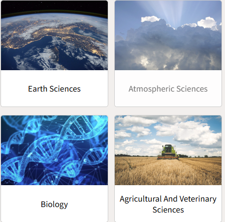
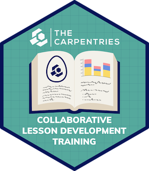
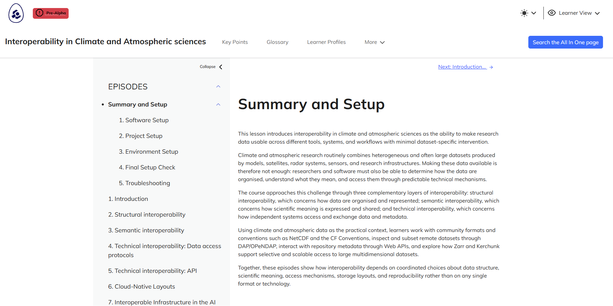

# Who are we {background-image="images/shared/4tu-logo.png" background-size="20%" background-position="96% 94%" background-repeat="no-repeat"}

::: {.columns}
::: {.column width="50%" .center-text}
{width=170 fig-alt="Portrait of Leila Iñigo de la Cruz"}

**Leila Iñigo de la Cruz**\
Digital Competences Trainer\
E: [L.M.InigoDeLaCruz@tudelft.nl](mailto:L.M.InigoDeLaCruz@tudelft.nl)
:::
::: {.column width="50%" .center-text}
{width=170 fig-alt="Portrait of Aleksandra Wilczynska"}

**Aleksandra Wilczynska**\
Data Solutions Engineer\
E: [A.E.Wilczynska@tudelft.nl](mailto:A.E.Wilczynska@tudelft.nl)
:::
:::

# Context of the lesson {background-image="images/shared/4tu-logo.png" background-size="20%" background-position="96% 94%" background-repeat="no-repeat"}

::: {.columns}

::: {.column width="33%" .center-text}

::: {.fragment data-fragment-index="1"}
{width=70% fig-alt="4TU.ResearchData logo"}
:::

::: {.fragment data-fragment-index="2"}

The repository for Natural, Engineering and Design sciences in NL

{width=70% fig-alt="Earth Sciences and Atmospheric Sciences"}

**Domain specific training needs**

:::

:::

::: {.column width="34%" .center-text}

::: {.fragment data-fragment-index="1"}
{width=80% fig-alt="Dutch Interoperability Network logo"}
:::

::: {.fragment data-fragment-index="3"}
**A national need on having best practices to embed interoperability into everyday research workflows of different disciplines.**
:::

:::

::: {.column width="33%" .center-text}

::: {.fragment data-fragment-index="1"}
{width=55% fig-alt="Carpentries Collaborative Lesson Development Training hex sticker"}
:::

::: {.fragment data-fragment-index="4"}
**Opportunity to build accessible and reusable lesson materials for the community**
:::

:::

:::

::: notes
We have many initiatives in the NL that revolve around building awareness on interoperability from a specific discipline standpoint.
:::

# Interoperability in Climate and Atmospheric sciences {background-image="images/shared/4tu-logo.png" background-size="20%" background-position="96% 94%" background-repeat="no-repeat"}

[{fig-alt="Screenshot of the lesson website" width=80% fig-align="center"}](https://4turesearchdata-carpentries.github.io/interoperability-climate-sciences/index.html)

::: {.center-text .small}

<https://4turesearchdata-carpentries.github.io/interoperability-climate-sciences/index.html>

**We began in November 2025 to develop this lesson**

:::

# Today is the Pilot of the lesson, thanks for participating! {background-image="images/shared/4tu-logo.png" background-size="20%" background-position="96% 94%" background-repeat="no-repeat"}

- Requirement to complete the development of the lesson and make it available to the community. 
- Your feedback will be fundamental to make it ready for others to teach also! 

# It is a Carpentry workshop {background-image="images/shared/4tu-logo.png" background-size="20%" background-position="96% 94%" background-repeat="no-repeat"}

::: {.incremental .center-text}

- It will be a combination between informational and hands-on workshop

- We will use the **Carpentries Code of Conduct** to ensure a safe and welcoming environment for everyone.

::: {.fragment .nonincremental .center-text}

- Use welcoming and inclusive language
- Be respectful of different viewpoints and experiences
- Gracefully accept constructive criticism
- Focus on what is best for the community
- Show courtesy and respect towards other community members

:::

:::

# Who are you? {background-image="images/shared/4tu-logo.png" background-size="20%" background-position="96% 94%" background-repeat="no-repeat"}

::: {.center-text}

<https://vevox.app/#/m/144372812>

{width=220 fig-alt="QR code for the Vevox session"}
:::
