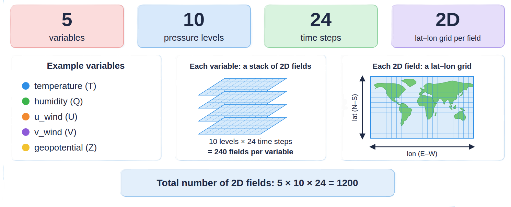
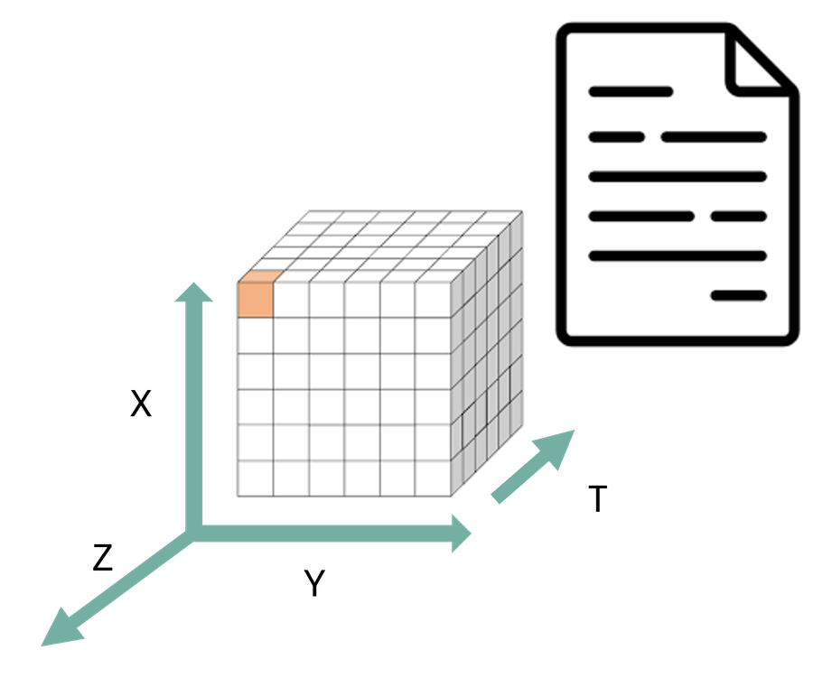

# What is structural interoperability?

::: notes
30 min: **10:15 -10:45**
:::

## The Problem

::: {.columns}

::: {.column width="62%"}
> Can another tool determine **how the dataset is organised** and process it **without bespoke instructions** from the person who created it?
:::

::: {.column width="38%"}
{fig-alt="Ash, a researcher" width="70%" fig-align="center"}
:::


:::

::: notes
**~1 min. One idea: the problem is needing the creator to explain the data.**

1. "Meet Ash, a researcher. Ash has just received a dataset from a colleague, and wants to open it and start working."
2. Read the question aloud, slowly. Pause on **"without bespoke instructions"**: "Bespoke instructions are the README, the email, the phone call to the person who made the file: 'which column is the time?', 'what does -999 mean?'"
3. "Structural interoperability is about being able to say **yes** to this question. Structure first, meaning later."

:::

## Structural Interoperability 

### Different software tools can reliably understand the organisation of a dataset

- What data objects exist (records, columns, arrays, variables)
- How they are represented (data types, dimensions, coordinates)
- How they relate to one another
- Which values represent missing data
- Whether the dataset follows expected structural rules

::: notes
**~2 min. One idea: structure is *how* data are organised, not *what* the values mean.**

1. **(Before any click)** "To answer the question from the last slide, a tool needs to find out five things." Read the five bullets quickly. 
:::

::: {.fragment}

::: {.callout-note appearance="simple"}
Machines can determine **how** a dataset is organised (structure), even if they do not yet understand **what** the values represent (semantics).
:::

::: notes
2. **(Click)** "Machines can find out *how* a dataset is organised without understanding *what* the values represent. The meaning comes in the semantic session later."
:::

:::

# How to achieve structural interoperability?
## A shared data contract

A **shared data contract** is an agreement about how data are organised.

::: notes
**~1 min. One idea: the contract is the data model, not the file extension.**

1. **(Before any click)** Can another tool read my data without asking me? Yes, if we agree on how data are organised. That agreement is the **data contract**.
:::

. . .

<br>

At its centre is the **data model**: the logical structure that software expects to find.

::: notes
2. **(Click 1)** At its centre is the **data model**: what software expects to find. A table, a set of arrays, a raster.
:::

. . .

<br>

::: {.callout-warning appearance="simple"}
A file extension (`.csv`, `.nc`, `.tif`, `.zarr`) is **not** the data model. It hints at how data are stored, but not how they are organised.
:::

::: notes
3. **(Click 2)** "A file extension is not the data model. `.nc` tells you how data are *stored*, not how they are *organised*."
:::

## Choosing a data model

The choice reflects **how you conceptualise the scientific data**. Choose a representation that preserves that structure with the **least** flattening, reconstruction, or artificial complexity.

| I think of my data as… | Natural model |
|---|---|
| "a collection of observations" | Tabular |
| "variables varying along several shared dimensions" | Multidimensional arrays |
| "a collection of meteorological forecast fields" | GRIB |
| "a georeferenced spatial surface" | Raster |
| "geographic objects with properties" | Geospatial features |

::: notes
**~1 min. One idea: start from how you picture your data, not from the file format.**

- Don't read every row. Read the first two aloud: "observations means a table; variables over shared dimensions means arrays."
- Key phrase: **flattening**. Forcing arrays into a table loses the explicit link between dimensions.

:::

## Choosing a data model: Example

::: {.columns}

::: {.column width="38%"}
Forecast dataset:

- 5 variables 
- 10 pressure levels 
- 24 time steps
- latitude-longitude grid
:::


::: {.column width="62%"}
{fig-alt="Image representing forecast data with 5 variables, 10 pressure levels, 24 time steps and  2D latitude-longitude grid"  fig-align="center"}
:::

:::

::: notes
**~1 min. Let the audience answer before you show the image.**

1. Read the dataset out: "5 variables, 10 pressure levels, 24 time steps, each a latitude-longitude grid."

:::

. . .

Which model fits best? 

::: notes
2. **(Click)** Ask "Which model fits best?" Wait 10-15 seconds and take one or two answers. Don't confirm yet.

:::

## {background-image="images/structural/data-models.png" background-size="contain" background-color="#ffffff"}
::: notes
**~2 min. One idea: same data, five structures. Choose the one that flattens least.**
Walk through left to right, about 10 seconds each:

1. **Tabular:** every grid-cell value becomes a row; the dimensions are repeated in each row. The same coordinates are stored millions of times.
2. **Multidimensional arrays (NetCDF, Zarr):** variables share time, level, lat, lon. The structure is kept as it is.
3. **GRIB:** 1200 separate messages, one per field, each with its own metadata.
4. **Raster (GeoTIFF):** 1200 georeferenced layers or bands.
5. **Geospatial features (GeoPackage):** each grid cell becomes a vector feature.

Answer to the question: arrays, or GRIB if it comes from a forecast system. "Each model can be stored in several formats, such as CSV or Parquet for tables and NetCDF or Zarr for arrays, but not all are equally appropriate for this data."

:::

# NetCDF: Network Common Data Form

## NetCDF: A data model for multidimensional scientific data

::: {.columns}
::: {.column width="40%"}
{fig-alt="Diagram of a NetCDF file consisting of dimensions, variables, and attributes" fig-align="center"}
:::
::: {.column width="60%"}
A portable, self-describing format for array data, created at Unidata (UCAR) in the late 1980s.

- **Dimensions:** named axes and their lengths
- **Variables:** typed N-dimensional arrays
- **Attributes:** metadata on a variable or the whole dataset

```text
float air_temperature(time, latitude, longitude)
float surface_pressure(time, latitude, longitude)

air_temperature:units = "K"
```
:::
:::

::: notes
**~2 min. One idea: NetCDF gives software three building blocks, and variables that share dimensions are explicitly related.**

1. **(Before the click)** "This is the model from the last slide, the multidimensional arrays box. Scientists needed a **common format** that would allow different tools/computers to understand its structure."
2. Walk through the three bullets using the picture and the code, 20 seconds each:
   - **Dimensions:** "`time`, `latitude`, `longitude`: named axes with a length."
   - **Variables:** "`air_temperature` is a float array over those three axes."
   - **Attributes:** "`units = K` is information *about* a variable, not data."

:::

. . .

Both variables **share dimensions**: the relationship is explicit, not inferred from where values sit in the file.

::: notes
3. **(Click)** "Both variables use the same three dimensions. Software can see that from the declarations, with no guessing."

:::

## NetCDF guarantees a structure, not a common one

::: {.columns}
::: {.column width="50%"}
**Dataset A**

```text
dimensions:
  time = 24, lat = 180, lon = 360
variables:
  float time(time)
  float lat(lat)
  float lon(lon)
  float temp(time, lat, lon)
  temp:_FillValue = -999.0
```
:::
::: {.column width="50%"}
**Dataset B**

```text
dimensions:
  lon = 360, lat = 180, t = 24
variables:
  float T(lon, lat, t)
  (no coordinate variables)
  (missing values = -999,
   not declared)
```
:::
:::

::: notes
**~2 min. One idea: both files are valid NetCDF, but a generic tool cannot tell how they correspond.**

1. **(Before any click)** "Same data, two NetCDF files. Dataset A and Dataset B both have dimensions, variables and types." Ask: "What can software tell for both?" (Dimensions, variables, types.) Then: "What can it *not* tell?" Give 10 seconds, then point at the differences:
   - **Dimension order:** `(time, lat, lon)` vs `(lon, lat, t)`.
   - **Names:** `temp` vs `T`, `time` vs `t`.
   - **Coordinate variables:** A has `lat(lat)` holding the axis values; B has none.
   - **Missing data:** A declares `_FillValue`; in B, -999 is just a number in the data.
:::

. . .

Both are **valid NetCDF**. A generic tool can read both, but it cannot tell which axis is which, or what marks missing data, without extra rules.

::: notes
2. **(Click 1)** "Both are **valid NetCDF**. A generic tool can read both, but it cannot tell which axis is which, or what marks missing data, without extra rules." Concrete example: "In B, an average would include the -999 values."
:::

. . .

::: {.callout-tip appearance="simple"}
**NetCDF** is the shared data model. **CF Conventions** are the community contract for using it consistently: coordinate variables, axes, fill values, grid mappings.
:::

::: notes
3. **(Click 2)** "The data model is shared; the **rules for using it** are agreed by a community. For climate and atmospheric data these are the **CF Conventions**."

Next: the exercise, where Ash inspects a real NetCDF file.
:::

## Exercise: help Ash inspect a NetCDF file {.smaller}

::: {.columns}
::: {.column width="70%"}
Ash has received a radar dataset and wants to know **how it is organised before writing any code.**

Open the OPeNDAP page for the IDRA dataset: \
**<https://edu.nl/xp63n>**


Help Ash identify:

1. the global attributes
2. the dimensions and their lengths
3. the coordinate variables *(variables with the same name as a dimension, holding its values)*
4. three data variables and their dimensions
5. the data types of those variables
6. one variable-level attribute that controls how missing data are represented
7. any variables that hold descriptive metadata as *data values* rather than as global attributes

:::
::: {.column width="30%"}
{fig-alt="Ash, a researcher" width="80%" fig-align="center"}
:::
:::

⏱ 8 minutes, in pairs. Do as much as time allows.

::: notes
**~8 min. One idea: Ash can answer all of this from the file itself.**

1. **(Start)** "Open the link and work in pairs." Hint: scroll to the **DDS** at the bottom of the page; Ctrl+F helps. Pairs need a couple of minutes to find their way around.
2. **(While they work)** Walk around and check that people have found the DDS. Dimensions appear as `name = length` in brackets. Coordinate variables are the ones named like a dimension, e.g. `range`. Watch out: the form shows indices (`0..511`), the DDS shows lengths (`512`).
3. **(Minute 6)** Check progress. Stop at 8, even if not everyone has finished.

:::

## Solution: Ash's findings (1/2) {.smaller}

::: {.columns}
::: {.column width="50%"}
**1. Global attributes**

`title`, `institution`, `history`, `references`, `Conventions`, `location`, `source`, `example`

`Conventions = "CF-1.4"`: the producer's *intention* to follow CF, not proof of conformance.

**2. Dimensions**

```text
time_raw_data       = 73728
sample_beat_signal  = 1024
time_processed_data = 144
range               = 512
scalar              = 1
```
:::
::: {.column width="50%"}
**3. Coordinate variables**

```text
time_raw_data(time_raw_data)
sample_beat_signal(sample_beat_signal)
time_processed_data(time_processed_data)
range(range)
```

`scalar` has no variable of the same name: it is just a length-one dimension used by several variables.
:::
:::

::: notes
**~2 min. One idea: dimensions are axes with a length; coordinate variables hold the values along an axis.**

1. Ask one pair: "How many dimensions did you find?" (Five, including `scalar`.) In the DDS they appear as `name = length`.
2. Coordinate variables: "`range = 512` says there are 512 positions. The variable `range(range)` says what each position is."
3. `scalar` has no variable of its own: it is just a length-one dimension used by several variables.
:::

## Solution: Ash's findings (2/2) {.smaller}

::: {.columns}
::: {.column width="50%"}
**4 and 5. Data variables, dimensions, types**

```text
i_hh(time_raw_data, sample_beat_signal)
    16-bit integer
equivalent_reflectivity_factor(
    time_processed_data, range)
    32-bit real
radial_velocity(time_processed_data, range)
azimuth_processed_data(time_processed_data)
```
:::
::: {.column width="50%"}
**6. Missing data**

`_FillValue: -999.0` on `equivalent_reflectivity_factor`, `differential_reflectivity`, `radial_velocity`, `spectrum_width`.

Its existence, location, and type are *structural*. Whether to exclude or interpolate missing values is an *analytical* decision.

**7. Metadata stored as variables**

`iso_dataset`, `product`, `station_details`: string variables, **not** global attributes.
:::
:::

::: {.callout-note appearance="simple"}
Ash learned all of this from the file itself, with no bespoke instructions: that is structural interoperability at work.
:::

::: notes
**~3 min. One idea: Ash learned all of this from the file itself.**

1. **Missing data:** `_FillValue` is structural, because it is declared in the file. What to do with the missing values is an analytical decision.
2. **Item 7:** string variables such as `station_details` are *data*, not global attributes.
3. **Callout:** "Ash needed no README, and the same steps work for any NetCDF file."

:::

## Key takeaways

- Structural interoperability is a **shared, machine-actionable contract** about how data are organised
- A file extension is **not** the data model; it only hints at how data are stored
- Choose the representation that matches your **data model**
- NetCDF provides a shared model: **dimensions, variables, attributes**
- **CF** adds the community rules for scientific interpretation

::: notes
Next: semantic interoperability (what do the values mean?) and technical interoperability (how do we retrieve them?).
:::
