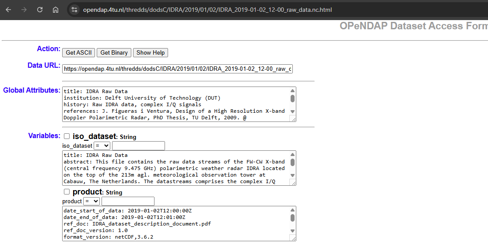

# Problem

::: {.columns}

::: {.column width="62%"}
> Can others understand the meaning of the data orrectly without making unnecessary assumptions?
:::

::: {.column width="38%"}
{fig-alt="Ash, a researcher" width="70%" fig-align="center"}
:::

:::


# Notion of semantic interoperability

::: notes
it is about shared and explicit meaning
:::


## What is semantic interoperability?

::: {.fragment .center-text}

A dataset is semantically interoperable when different people and software systems can interpret its variables, categories, relationships, and measurement context consistently because those meanings are expressed using documented, community-agreed terms and rules.


::: {.fragment}

### Good to know that: 

::: {.incremental}

* This definition does not require every explanation to be written directly inside one file.
* Meaning can be expressed through persistent identifiers that resolve to external vocabularies, code lists, specifications, instruments, methods.
* What matters is that the references and relationships are explicit and machine-actionable rather than hidden in personal knowledge, filenames, or informal documentation.
:::
:::

:::

# Structure and meaning are different, but connected

::: {.incremental}

- The *structural rule* tells software *where to find* the information and which variable it describes, while the *semantic rule* tells software *how to interpret* that information.

:::

::: {.fragment}


- Example: 

```text
float temperature(time, lat, lon);
    temperature:standard_name = "air_temperature";
    temperature:units = "K";
```

Structural rule: The *standard_name* attribute must be attached to the *variable* it describes. In this case, *temperature*.

Semantic rule: The value *air_temperature* must be a recognized/standard term, where it has a precise scientific definition.

:::


# Semantic resources to express meaning

::: {.fragment}
::: {.row}

::: {.labelled}
::: {.pill .p-grey}
Controlled vocabularies
:::
Approved terms with definitions and governance e.g. CF
:::
::: {.labelled}
::: {.pill .p-red}
Code lists
:::
Permitted values or codes for a particular field
:::
::: {.labelled}
::: {.pill .p-tan}
Peristent identifiers
:::
Links that connect a dataset or metadata element to an authoritative definition, instrument, method, vocabulary term, or other related resource.
:::
::: {.labelled}
::: {.pill .p-cream}
Ontology
:::
Formal concepts, properties, and relationships that may support logical reasoning
:::
:::
:::

# Semantic interoperability through the Climate and Forecast (CF) Conventions

::: {.incremental}

- The CF Metadata Conventions provide **standard ways** to describe the **meaning and context of variables in NetCDF datasets**. This helps researchers and software determine what the data represents and where and when it applies.

:::


# Main CF elements 

::: {.incremental}

- `standard_name` — What is being measured? Gives a variable a standardised name with a defined scientific meaning, such as `air_temperature` or `precipitation_flux`.
- `units` — How are the values expressed? Specifies the physical units of the variable. When a `standard_name` is used, the units must be physically compatible with its canonical units.
- `bounds` and `cell_methods` — What does each value represent? `bounds` can describe the extent of a coordinate interval, while `cell_methods` describes operations such as a mean, sum, or maximum over space or time.
- `featureType` — What kind of observations are these? Describes discrete sampling geometries such as time series, profiles, or trajectories.

:::

::: {.fragment}

::: {.callout-note appearance="simple"}

Together, these elements make the scientific meaning and context of the data more explicit and machine-readable.

:::
:::

::: {.fragment}

::: {.callout-warning appearance="simple"}

CF compliance does not guarantee that the scientific values are correct.

:::
:::


<!-- # Exercise in pairs (5 mins)

::: {.center-text}
**Can these variables be compared?** (Think-Pair-Discuss)

<span class="small"><https://4turesearchdata-carpentries.github.io/interoperability-climate-sciences/semantic-interoperability.html#semantic-interoperability-through-the-cf-conventions></span>
:::

::: notes
"Easy" means with the fewest assumptions possible about how to integrate them, and also less manual intervention.
::: -->

# Exercise (plenum)

::: {.center-text}
**Semantic interoperability: True or False?**

::: {.incremental}

::: {.small}

- A NetCDF file with dimensions, variables, and units is semantically interoperable by default.
    - **False** : NetCDF provides a self-describing structure, but dimensions and units do not fully define scientific meaning, context, statistical treatment, or relationships.
- Climate and Forecast (CF) standard names allow software to distinguish different kinds of temperature.
    - **True** : CF standard names distinguish concepts such as `air_temperature`, `sea_surface_temperature`, and `surface_temperature` through controlled terms and definitions.
- Semantic interoperability mainly benefits human readers, not automated workflows.
    - **False** : Semantic interoperability is about shared and explicit meaning, which allows both humans and software to interpret the data consistently.
- Two datasets using the same CF standard name can always be compared directly without further interpretation.
    - **False** : A shared standard name is strong evidence that variables represent the same physical quantity, but direct comparison still depends on coordinates, units, heights or depths, cell methods, bounds, etc. 
- Semantic interoperability can be achieved reliably through locally invented variable names, without community-agreed definitions.
    - **False** : Local names may be understandable within one project, but reliable interoperability requires mappings to shared definitions, vocabularies, or identifiers.
- A descriptive *long_name* has the same machine-actionable status as a valid CF standard_name.
    - **False** : *long_name* is normally free text. A CF *standard_name* must be selected from the governed Standard Name Table and has a defined meaning and canonical unit.

:::

:::

:::

# What does CF-compliant mean?

::: {.incremental}

- A NetCDF file is CF-compliant relative to a declared CF version when it satisfies the requirements of that version and uses CF terms according to their defined meanings.
- CF compliance report distinguish between:
    - requirements, which must be satisfied for conformance; and
    - recommendations, which improve interoperability but are not always mandatory.
- Compliance is version specific, and a file may be compliant with one version but not another.
:::


# Compliance check

::: {.columns}
::: {.column width="50%" .center-text}
::: {.pill .pill-lg}
Data
:::

<span class="small">[opendap.4tu.nl: IDRA_2019-01-02_12-00_raw_data.nc](https://opendap.4tu.nl/thredds/catalog/IDRA/2019/01/02/catalog.html?dataset=IDRA_scan/2019/01/02/IDRA_2019-01-02_12-00_raw_data.nc)</span>

{fig-alt="OPeNDAP dataset access form for the IDRA dataset" width=90%}
:::
::: {.column width="50%" .center-text}
::: {.pill .pill-lg}
Tool
:::

<span class="small"><https://compliance.ioos.us/index.html></span>

[{fig-alt="IOOS Compliance Checker" width=90%}](https://compliance.ioos.us/index.html)

↓

::: {.pill .p-grey}

Report

:::
:::
:::

::: notes
Show an example of a report from the compliance check. Lesson_development\data\compliance_report_IDRA_2019-01-02_12-00.txt
:::

# Recommended workflow

::: {.workflow}

::: {.step .step-start}
**Original NetCDF dataset**

<span class="small">Missing or inconsistent CF metadata</span>
:::

<div class="workflow-arrow">↓</div>

::: {.step}
**1. Validate**

<span class="small">IOOS Compliance Checker</span>
:::

<div class="workflow-arrow">↓</div>

::: {.step}
**2. Inspect and correct**

<span class="small">Python `xarray` or NetCDF operators</span>
:::

<div class="workflow-arrow">↓</div>

::: {.step}
**3. Validate again**

<span class="small">Check whether outstanding CF violations remain</span>
:::

<div class="workflow-arrow">↓</div>

::: {.step .step-success}
**✓ Validated NetCDF dataset**

:::

:::