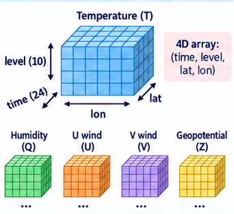

# What is technical interoperability?
## The Problem

::: {.columns}
::: {.column width="62%"}

> How can one computer system access data held by another system?

> How can a computer access scientific data stored on a remote system without necessarily downloading the entire file?
:::
::: {.column width="38%"}
{fig-alt="Ash, a researcher" width=70% fig-align="center"}
:::
:::

## Definition

Technical Interoperability concerns the mechanisms that allow independent systems to communicate and **exchange data** through agreed technical **interfaces** and **protocols**

## Example: one variable, one period, one region

::: {.columns}
::: {.column width="65%"}
A climate dataset is stored in a research data repository. A researcher is interested in **one variable**, covering **a particular period** and **a geographical region**.

 

Consider two approaches:

1. Download the complete file and perform the selection locally
2. The remote infrastructure provides a mechanism to request only the required part

[**Which one is more suitable...?**]{.fragment}

:::
::: {.column width="35%"}
{fig-alt="A 4D array (time, level, lat, lon) and the variables that share its dimensions"}
:::
:::

::: {.fragment}
::: {.callout-note appearance="simple" title="It depends on the task"}
- **Downloading the file** is fine for small files, or when you need the complete dataset.

- **Requesting only the part you need** matters for large datasets and automated workflows. 
:::
:::

::: notes
For example, imagine a Python workflow that runs every day and retrieves temperature data for the Netherlands from a global climate dataset. If the workflow has to download the entire global file every time, it repeatedly transfers a large amount of unnecessary data, consumes local storage, and adds extra steps for managing those downloaded files.
:::

# Concepts

## {background-image="images/protocols/storage-is-not-access.png" background-size="contain" background-color="#ffffff"}

## {background-image="images/protocols/protocol-defines-access.png" background-size="contain" background-color="#ffffff"}

# DAP and OPeNDAP
## DAP and OPeNDAP

::: {.callout-important appearance="simple" title="The problem"}
Important scientific datasets were spread across institutions, each with its own way of storing and accessing data.
:::

::: {.callout-tip appearance="simple" title="The idea"}
A common way to access data, wherever it is stored.
:::

> "A URL equals a dataset."
>
> "A URL with constraints equals a subset."

::: notes
The idea came out of a 1993 workshop at the University of Rhode Island (with MIT, supported by NASA, NOAA and The Oceanography Society). The first Distributed Oceanographic Data System (DODS) was implemented in 1995 and presented at the Fourth International World Wide Web Conference.

It started in oceanography, but the problem was not specific to ocean data. Climate, atmospheric science and remote sensing faced the same challenge, so DODS evolved into the Data Access Protocol (DAP).

OPeNDAP Inc. was formed as a nonprofit in 2000 to maintain and develop the infrastructure.

Later milestones (mention only if asked): DAP2 became a NASA Earth Science Data Systems standard in 2005, Hyrax was first released in 2006, and DAP4 followed in 2014 with a richer data model.
:::

## Who is who?

| | |
|---|---|
| **DAP** | the protocol: how clients and servers talk |
| **OPeNDAP** | the project and software ecosystem behind DAP |
| **Hyrax, THREDDS** | data servers that implement DAP |

[ Researchers just receive an endpoint URL. Data providers run the server.]{.fragment}

::: notes
For researchers accessing existing datasets, the distinction is usually invisible. For data providers and infrastructure operators it matters: someone has to operate the server that interprets DAP requests and connects them to the underlying datasets.

The main purpose has stayed the same: allow independent scientific clients to access distributed, structured data through a common protocol.
:::

# Hands-on

## Let's make use of DAP
We will access remote NetCDF datasets stored in 4TU.ResearchData using the DAP protocol
 

[<https://edu.nl/9fh7g>]{.r-fit-text}

# Wrap-up
## Key takeaways

- Technical interoperability is about how **systems agree to request and exchange data** over a network
- **Storage is not access**: remote data still needs an agreed access mechanism
- **DAP** is the protocol. **OPeNDAP** is the project behind it. **Hyrax and THREDDS** are servers that implement it
- With DAP you can explore a remote dataset **without downloading it**, and **subset on the server** before any data is transferred
- A repository can be more than a place to store data: it can also make data **accessible to machines, selectively**

::: notes
These mirror the episode's key points. The last one is the main message for data stewards: when choosing infrastructure, ask not only "Can it store my NetCDF files?" but also "How will machines access the data after I publish them?"

Next: APIs, the other main way systems exchange data.
:::