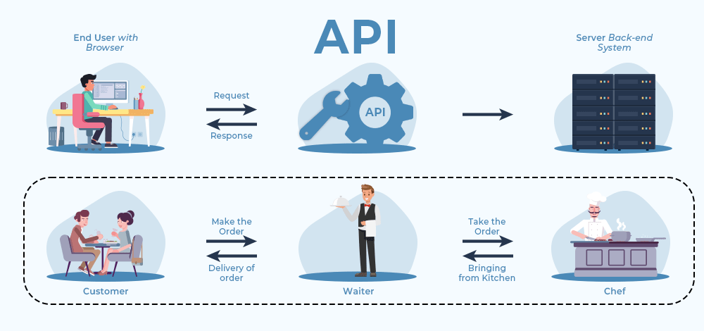

## The Problem

::: {.columns}

::: {.column width="62%"}
> How can one computer system access data held by another system?


::: {.column width="38%"}
{fig-alt="Ash, a researcher" width="70%" fig-align="center"}
:::

:::

:::

# Notion of technical interoperability

## What is technical interoperability?


::: {.fragment .center-text}

Tecnical interoperability refers to the ability of software systems to reliably exchange data and metadata without human intervention

:::


::: {.fragment}

  - standardized protocols like OPeNDAP
  - **APIs (Application Programming Interfaces) that define how software systems can interact with each other in a structured and predictable way**
:::


# [01]{.badge} What are APIs

:::{.fragment .center-text}
An API (**Application Programming Interface**) defines how one software system can interact with another in a structured and predictable way.
:::

## Customer, waiter, chef analogy

{fig-alt="Client and server communicating through an API, and the waiter analogy: customer, waiter, chef" width=65% fig-align="center"}

::: notes
An API is like a waiter in a restaurant. You don't go into the kitchen and cook the meal yourself. You just place an order and hope the kitchen doesn't return it to you.
:::

## [02]{.badge} APIs can take different forms depending on where and how systems communicate

::: {.columns}

::: {.column width="50%"}

::: {.fragment .center-text}

::: {.pill .pill-lg .p-orange}
Library APIs
:::

**Library or programming APIs** allow software code to interact with functions, classes, or modules provided by a software package.

:::

::: {.fragment .center-text}

::: {.pill .pill-lg .p-red}
OS APIs
:::

**Operating system APIs** allow applications to interact with system resources such as files, memory, or hardware.

:::

:::

::: {.column width="50%"}

::: {.fragment .center-text}

::: {.pill .pill-lg .p-grey}
Database APIs
:::

**Database APIs** allow applications to query and modify information stored in databases.

:::

::: {.fragment .center-text .focus}

::: {.pill .pill-lg .p-cream}
Web APIs
:::

**Web APIs** provide a machine-accessible interface through which one system can request data or services from another over the web.

:::

:::

:::


## [03]{.badge} Web APIs usually define: 


1. **Endpoints**: the address of the resource exposed by the API
2. **HTTP methods**: they use a **shared vocabulary** of methods. GET, POST, PUT, DELETE to define how to exchange **resources** across the web.
3. **Parameters**: additional information to refine the request
4. **Representation**: most Web APIs today use the **JSON** format to exchange data.
5. **Authentication**: mechanism to identify users or software and determine which operations they are allowed to perform.

::: notes
HTTP: Hyper Text Transfer Protocol

JSON: JavaScript Object Notation
:::

## APIs connect structural and semantic interoperability

::: {.row}
::: {.labelled}
::: {.pill .p-grey}
Structural interoperability
:::
JSON responses must follow well defined schemas
:::
::: {.arrow}
→
:::
::: {.pill .pill-lg .p-orange}
APIs
:::
::: {.arrow}
←
:::
::: {.labelled}
::: {.pill .p-salmon}
Semantic interoperability
:::
Metadata fields, controlled terms ensure that machines interpret content consistently
:::
:::

*Without structural and semantic agreement, an API may be technically functional but scientifically meaningless.*

::: notes
Without structural and semantic agreement, an API may be technically functional but scientifically meaningless.
:::

## [04]{.badge} Why APIs are relevant for research : A typical workflow


::: {.fragment}


::: {.row}
::: {.pill .pill-lg .p-orange}
**Query** a data service from radar observations
:::
::: {.arrow}
→
:::
::: {.pill .pill-lg  .p-grey}
**Retrieve** metadata and identify data files
:::
::: {.arrow}
→
:::
::: {.pill .pill-lg  .p-red}
**Process** the selected data in Python
:::
::: {.arrow}
→
:::
::: {.pill .pill-lg  .p-tan}
**Generate** derived products
:::
::: {.arrow}
→
:::
::: {.pill .pill-lg  .p-cream}
**Publish** the results and metadata to a research repository
:::
:::
:::

::: notes
HTTP: Hyper Text Transfer Protocol

JSON: JavaScript Object Notation
:::

# True or False Exercise


## A Web API can allow software to retrieve data from a repository without a user manually interacting with the repository website.

::: {.fragment}
::: {.pill .pill-lg  .p-cream}
**True**
:::
:::

## All APIs are Web APIs.

::: {.fragment}
::: {.pill .pill-lg  .p-cream}
**False**
:::
:::

## Web API must return JSON in order to be technically interoperable.

::: {.fragment}
::: {.pill .pill-lg  .p-cream}
**False**
:::
:::

## If two systems can exchange data through an API, this automatically means that they interpret the scientific meaning of the data in the same way.

::: {.fragment}
::: {.pill .pill-lg  .p-cream}
**False**
:::
:::

## APIs remove the need for structural and semantic interoperability.

::: {.fragment}
::: {.pill .pill-lg  .p-cream}
**False** : Data still need predictable structures and shared meaning to be reused correctly!!
:::
:::

# Hands on 4TU.ResearchData Web API


## [05]{.badge} Hands-on: 4TU.ResearchData Web API

::: {.pill .pill-lg  .p-cream}
The Unix terminal allows HTTP requests using `curl`.

`curl` = client URL > send requests and receive responses.
:::


```bash
curl -X <HTTP_METHOD> <URL> -H "<HEADER_KEY>: <HEADER_VALUE>" -d '<BODY_DATA>'
```


- Base URL: <https://data.4tu.nl>
- Specific resource URL (endpoint): <https://data.4tu.nl/v2/articles>
- Open your Unix terminal


## **Exercise 1: checking the connection with the server using the web browser and `curl` in the Unix terminal**

- Open a web browser and write: <https://data.4tu.nl/v2/articles>
- On the Unix terminal write:

  ```bash
  curl -X GET https://data.4tu.nl/v2/articles | jq
  ```

- How are both responses compared to each other?


## Exercise 2: Exploring the 4TU.ResearchData API documentation:


API documentation: <https://data.4tu.nl/api/docs>

1. Show in the terminal the metadata of 2 datasets published since May 1st 2025 using `curl` and `jq` to format the output.
2. Save the information of 2 datasets published since May 1st 2025 using `curl` to a file called `data.json` in the current directory.
3. Show in the screen the metadata of 10 software published since January 1st 2025.

# Key takeways

- APIs operationalize technical interoperability by enabling standardized machine-to-machine interaction.

- Web APIs use HTTP methods, predictable endpoints, JSON representations, stable identifiers, and authentication mechanisms.

- APIs depend on structural interoperability (schemas) and semantic interoperability (controlled vocabularies).

- Command-line tools such as curl provide direct access to API functionality and enable automation.

- The 4TU.ResearchData API supports full dataset lifecycle management: discovery, creation, metadata update, file upload, and submission for review