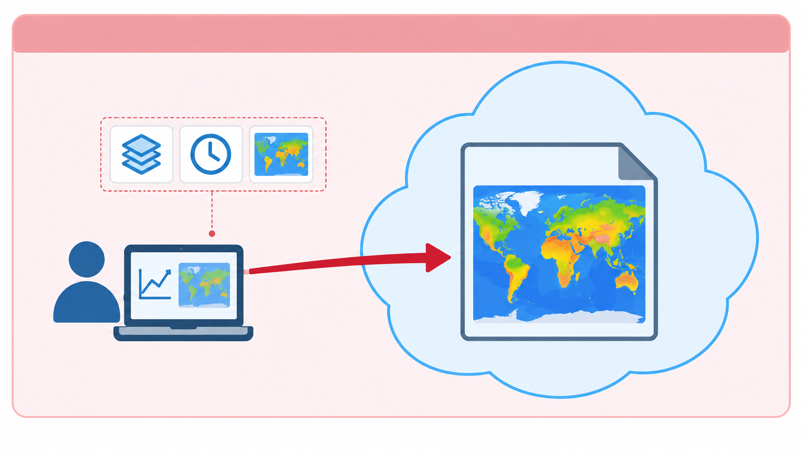
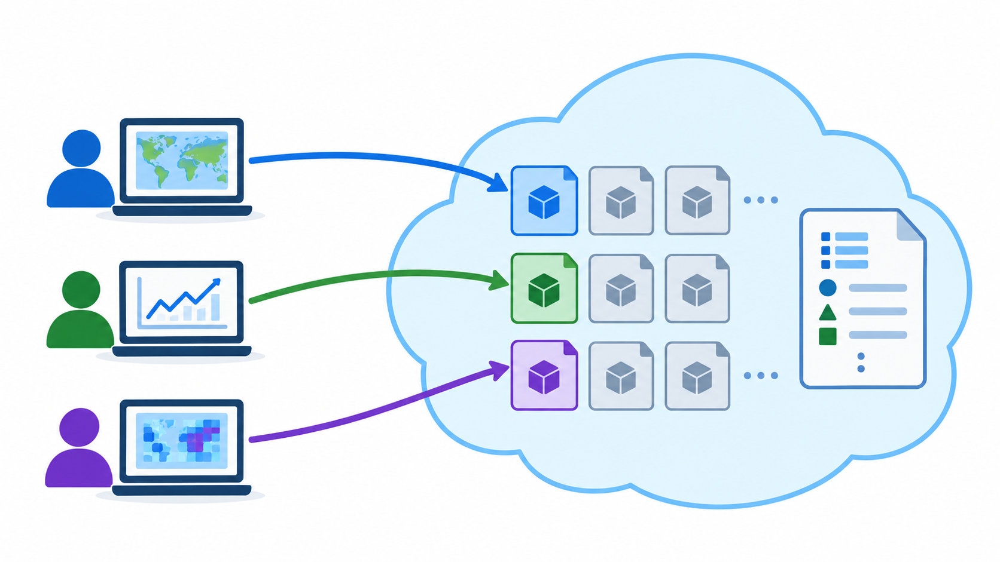
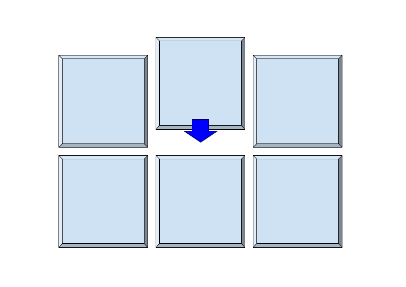

# Problem

::: {.columns}

::: {.column width="62%"}
> Is my data optimised for access even if it is stored in the cloud with a predictable format and following standard metadata conventions?

::: {.column width="38%"}
{fig-alt="Ash, a researcher" width="70%" fig-align="center"}
:::

:::

:::

# A bit of context

::: {.fragment}

Climate datasets are often huge, but researchers usually need only a small part of the data for a particular analysis. A researcher might only need one variable, a short time period, one pressure level, or a small geographical region.

See [Climate Data Store from Copernicus](https://cds.climate.copernicus.eu/datasets)

Large data collections such as [ERA5](https://cds.climate.copernicus.eu/datasets/reanalysis-era5-single-levels?tab=overview) can extend across **terabytes** or **petabytes** of data.

:::

::: notes
Large data collections such as [ERA5](https://cds.climate.copernicus.eu/datasets/reanalysis-era5-single-levels?tab=overview) or [CMIP6](https://wcrp-cmip.org/cmip-phases/cmip6/) can extend across terabytes or petabytes of data.

Researchers, however, rarely need an entire collection for a particular analysis. A researcher might only need one variable, a short time period, one pressure level, or a small geographical region.
:::

# But, how can that be achieved? {.center-text}

::: {.fragment}

::: {.callout-warning appearance="simple"}

Cloud native does not just mean "in the cloud"

:::

:::

::: {.fragment}

::: {.callout-note appearance="simple"}
Cloud native is about the access model
:::

:::

::: {.fragment}

::: {.small}
1. Cloud native layouts support workflows in which software retrieves only selected parts of a dataset and can perform multiple reads in parallel.
2. The important idea is NOT only **where the data are stored**, but **how the data are organised for access**.
:::

:::

# Lets take a step back on how the traditional file-based works 

## One file, one unit of access

{fig-alt="A researcher accessing one large NetCDF file stored in the cloud"}

::: notes
Many traditional scientific workflows are organised around files. A researcher finds a file on a repository or server, downloads or opens it, selects the required observations, and then performs the analysis.
:::

## Cloud native layouts

Rationale: Break down each file into smaller independently accessible parts

{fig-alt="Several users reading separate parts of a dataset stored in the cloud"}

# NetCDF vs Zarr {.smaller}

## NetCDF

::: {.row}
::: {.center-text}
**NetCDF:**\
a primarily file-oriented representation

A NetCDF dataset is commonly packaged into a single binary file.
:::
::: {.arrow}
→
:::
::: {.center-text}
It gets uploaded to an object storage cloud infrastructure
:::
::: {.arrow}
→
:::
::: {.checks}
- Remote access is possible
- Software can use HTTP byte-range requests to retrieve regions of the file.
:::
:::

::: {.fragment}
::: {.callout-warning appearance="simple"}
But it is not a scalable model for workflows involving many repeated subsets, many parallel readers
:::
:::

## {background-image="images/cloud/netcdf-in-object-storage.png" background-size="contain" background-color="#ffffff"}

## Zarr : a cloud-oriented chunked representation

{fig-alt="Zarr storage layout"}

::: {.fragment}

- Zarr divides arrays into smaller pieces called **chunks**. 
- A chunk represents a region of a multidimensional array, can be read independently from the others 
- The size of the chunk is a design choice that should match the expected access pattern.

:::

## If a Zarr object is stored in an object storage cloud infrastructure

::: {.fragment}
::: {.checks}
- Remote access is possible.
- Each chunk can be retrieved independently
- Supports parallel access
:::

::: {.pill .pill-lg .p-cream}
A  Zarr storage layout can expose those chunks as **independently addressable parts of the storage system**
:::

:::

## {background-image="images/cloud/zarr-in-object-storage.png" background-size="contain" background-color="#ffffff"}

## So, then: {.smaller}

::: {.checks}
- Zarr should not be understood simply as a replacement for NetCDF
- NetCDF remains fundamental to climate and atmospheric sciences, large scientific archives, established tools, community conventions, repositories, and existing research workflows depend on it.
- Zarr becomes particularly relevant when multidimensional datasets need to be accessed repeatedly over a network
- Both can represent multidimensional scientific data. What changes is how that data is physically organised and retrieved.
:::

## Exercise: What changes in interoperability? {.smaller} (Think/Discuss)

Imagine that the same scientific dataset is moved from a conventional NetCDF file representation to a cloud-native layout such as Zarr. Which aspects of interoperability change when moving from a conventional NetCDF file representation to a cloud-native layout such as Zarr? Which aspect is not automatically changed or improved by this move?

As you discuss, consider these three questions:

- Does the physical organisation of the data change?
- Does the way software accesses the data change?
- Does the scientific meaning of variables, units, and coordinates automatically change?

## Self-paced demo

**Hands-on:**\
**Creating Zarr-compatible access from NetCDF , with Kerchunk**

# Key takeaways

- Cloud-native data layouts address the problem of efficiently accessing small parts of very large remote datasets.
- Object storage manages independently addressable objects rather than providing the same access model as a traditional filesystem.
- A conventional NetCDF file can be stored in the cloud without becoming a cloud-native data layout.
- Zarr uses a chunk-oriented representation that maps naturally onto selective and parallel access in object storage.
- Cloud-native layouts affect structural and technical interoperability; semantic interoperability still depends on conventions such as CF.
- Kerchunk provides a Zarr-compatible reference view of existing NetCDF or HDF5 data without duplicating the underlying scientific data.
- OPeNDAP, Zarr, and Kerchunk provide different approaches to efficient remote scientific-data access.