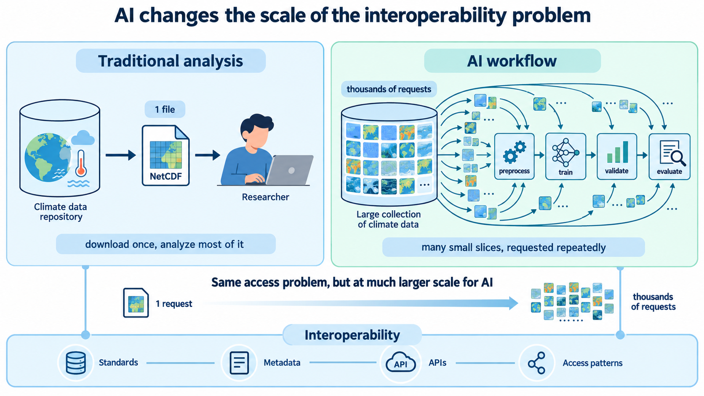
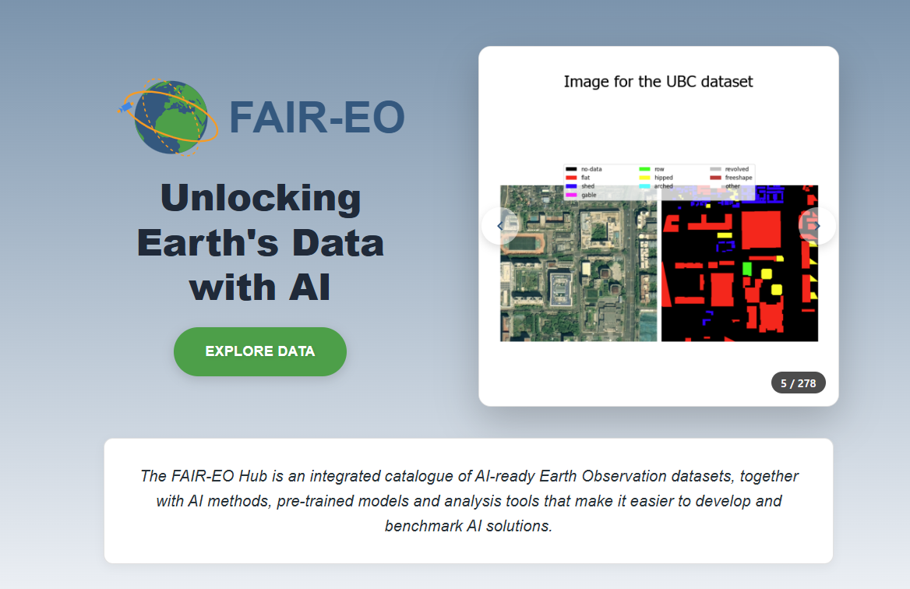

<!-- Five slides in total: the title slide plus the four sections below. -->

# Problem

::: {.columns}

::: {.column width="62%"}

> How can Ash train an extreme-rainfall prediction model using years of radar and atmospheric data **without correcting each dataset manually**?

:::

::: {.column width="38%"}
{fig-alt="Ash, the researcher featured throughout the interoperability lessons" width="70%" fig-align="center"}
:::

:::

::: notes
Previously, Ash compared two IDRA radar datasets. She now wants to build an extreme-rainfall prediction model using several years of radar observations, atmospheric observations, and reanalysis data. A human can sometimes rename variables, inspect a README, or download individual files, but a large automated pipeline cannot reliably depend on those interventions.

AI is not a fourth interoperability layer. It makes the existing structural, semantic, and technical requirements more visible as the workflow becomes more automated and data-intensive.
:::

# What does “AI-ready” mean?

::: {.fragment .center-text}

**AI-ready infrastructure** enables a **defined machine-learning workflow** to discover, access, interpret, retrieve, transform, and trace the data it needs with minimal dataset-specific manual intervention.

:::

::: {.fragment}

- AI readiness is task-dependent. 

- No single data format or technology automatically makes a dataset AI-ready.

- AI readiness therefore builds on interoperability, but extends beyond it.

:::

# AI changes the scale of the interoperability problem

# {width="70%" fig-align="center"}

# Interoperability does not guarantee trustworthy AI

- Interoperability is an important foundation for automated and reproducible AI workflows, but it should not be confused with scientific validity or model quality. 

-  Datasets can be structurally, semantically, and technically interoperable while still contain measurement errors.
- Interoperability **does not** address questions of data quality, representativeness, modelling methodology, validation, uncertainty, and scientific interpretation.

# Example : AI for Earth Observation 

{width="70%" fig-align="center"}

https://eodata.bvlabs.ai/ai4eo/#/

# Anemoi European framework for AI

{width="70%" fig-align="center"}

https://www.ecmwf.int/en/about/media-centre/aifs-blog/2026/anemoi-european-framework-ai

# Key takeaways

- AI readiness is task-dependent. No single data format or technology automatically makes a dataset AI-ready.

- AI does not introduce a new interoperability layer. Instead, automated AI workflows increase the importance of structural, semantic, and technical interoperability.

- Interoperable source data provide a foundation from which task-specific AI training datasets can be constructed reproducibly.

- Cloud-native layouts such as Zarr can improve selective and parallel access for suitable large-scale workflows, but they do not automatically improve semantic interoperability or data quality.

- Persistent identification, provenance, and versioning complement interoperability by connecting models and derived training data to the exact source data and transformations from which they were produced.

- Interoperability supports reproducible and inspectable AI workflows, but it does not guarantee that training data are representative, scientifically appropriate, unbiased, or sufficient for a particular model.